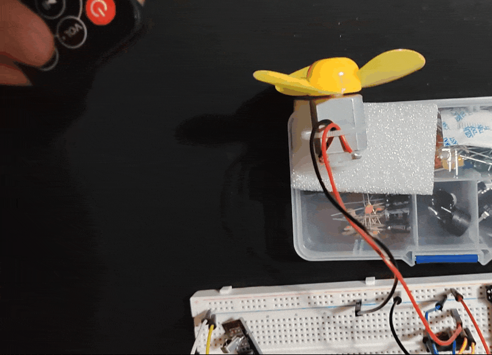

# DC-Motor-Controller-with-IR-Remote

> **Implementation Note:** Drivers for IR receiver were written entirely from scratch by me using ATmega 2560 standard AVR libraries which are also available in my documentation. Direct register manipulation was performed using my own ATmega 2560 memory register map, [linked here](https://github.com/RaresCM/ATMega2560-Custom-Documentation).

## Overview
My custom simple DC motor driver built on a ATmega 2560 development board platform in bare metal C. The build uses a standard 9V DC motor, a L293D Darlington Pair IC for the forward and backward DC motor operations, a common IR receiver module, a common IR remote control and an external 9V supply for the IC.

## Key Features
This project was built to apply concepts from my EEE course as well as module integration and features:
* Custom driver for receiving and reading IR codes
* Pressed key logic to avoid multiple inputs
* PWM driven L293D for the motor speed
* 9V external power for the motor
* Slow speed reduction logic when changing direction to avoid overloading the IC with a back voltage spike
* Multiple incremental speed settings using fast forward and backwards buttons on the remote
* Dedicated On and Off buttons on the remote

## Repository Structure
- /main.c - The main code for the clock to be uploaded to the chip
- /platformio.ini - PlatformIO settings to be used with VS code and PlatformIO extension
- /designlog.md - My log of findings, learning and obstacles encountered during the design of the alarm clock
